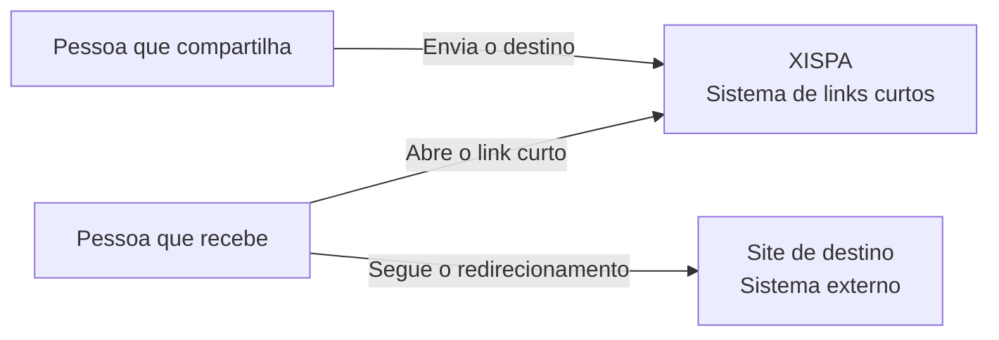
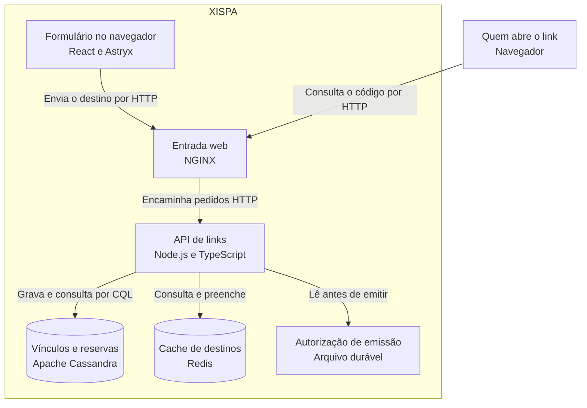
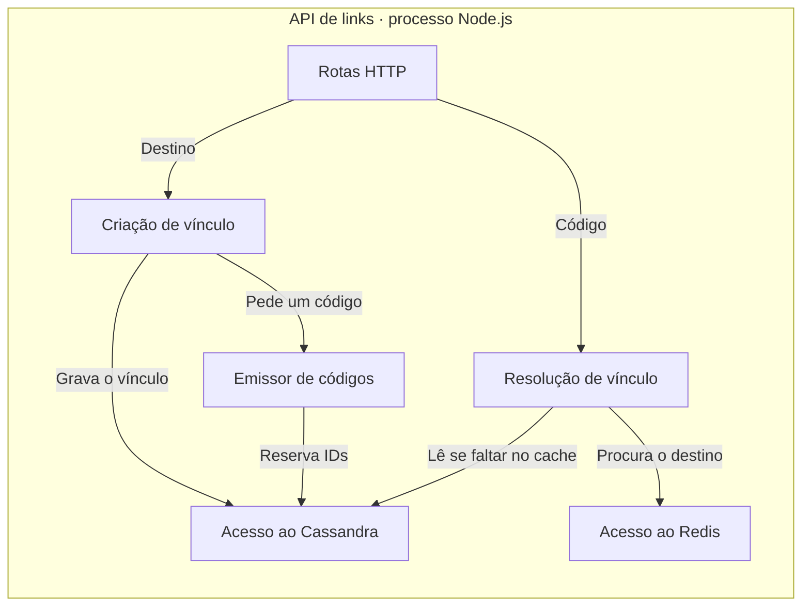

# Arquitetura do XISPA

Na demonstração, uma pessoa cola `https://www.google.com/` no formulário. O XISPA responde com um link no domínio `xispa.test` que termina em sete caracteres. Ao abrir esse link, o navegador volta ao XISPA para descobrir o destino e só então carrega o Google. O código identifica uma associação entre dois endereços. Quem hospeda o serviço precisa conservá-la por dez anos civis, mesmo que a aplicação reinicie ou que outra máquina atenda ao próximo clique. [Demonstração](../README.md#demonstração)

Criar e abrir um link impõem exigências diferentes. Na criação, a API precisa entregar um código exclusivo e garantir que o destino já esteja gravado quando alguém receber o link. Depois, o mesmo código pode ser aberto milhares de vezes. A arquitetura combina um registro durável no Cassandra com uma cópia temporária no Redis para acelerar essas leituras.

## 1. Contexto — quem cria o link e quem o abre

No primeiro nível do modelo C4, o XISPA aparece como um único sistema. Quem compartilha escolhe o destino. Quem recebe precisa apenas de um navegador. O site de destino é um sistema independente, mesmo quando a visita começa por um link do XISPA. [Modelo C4](https://c4model.com/diagrams)



O domínio curto pertence à instalação. Qualquer pessoa pode criar ou abrir links sem cadastro. O conteúdo da página continua no site de destino, que recebe a visita diretamente do navegador. É essa passagem de um sistema ao outro que aparece no cabeçalho HTTP `Location`.

### As três rotas, com o mesmo link

**Criar um link — `POST /api/v1/encurtar`.** O botão **Encurtar** envia o endereço original no campo `url`. Com o XISPA na porta padrão, o comando abaixo faz o mesmo pedido pelo terminal. [Instalação local](instalacao.md)

```sh
curl -i http://localhost:8080/api/v1/encurtar \
  -H 'Content-Type: application/json' \
  -d '{"url":"https://www.google.com/"}'
```

A opção `-d` envia os dados por POST. Nesta execução, o serviço confirmou a criação com `201 Created` e devolveu o endereço curto no corpo da resposta.

```http
HTTP/1.1 201 Created
Content-Type: application/json; charset=utf-8

{"short_url":"http://localhost:8080/amlTKua"}
```

O `201` só é enviado depois que o Cassandra confirma a gravação. Na sua instalação, copie o valor de `short_url` que aparecer. Uma nova criação para o mesmo destino pode gerar outro código. O domínio e a porta vêm da configuração `PUBLIC_ORIGIN`.

**Abrir o link — `GET /{codigo}`.** Acessar o endereço curto no navegador consulta o código presente no caminho. Para ver a resposta antes de o navegador seguir para o Google, digite `read -r LINK` no terminal e pressione Enter. Cole o endereço que você recebeu em `short_url`, sem aspas, e pressione Enter de novo. O curl pode agora consultar esse mesmo link.

```sh
curl -i "$LINK"
```

```http
HTTP/1.1 302 Found
Location: https://www.google.com/
Cache-Control: no-store
```

O curl exibe o primeiro salto. O navegador segue o `Location` e faz uma nova requisição ao Google. O XISPA usa um redirecionamento temporário (`302`) e pede ao cliente que não armazene a resposta (`no-store`). Assim, da próxima vez que o link for aberto, o serviço poderá verificar se ainda está dentro da validade. [Semântica do 302 na RFC 9110](https://www.rfc-editor.org/rfc/rfc9110.html#section-15.4.3)

**Consultar o destino por JSON — `POST /api/v1/redirecionar`.** Uma aplicação também pode enviar o endereço curto inteiro no campo `short_url`. Ele deve pertencer à mesma origem (protocolo, domínio e porta) e terminar em uma barra seguida do código, sem consulta ou fragmento. Este pedido usa o endereço guardado na etapa anterior.

```sh
curl -i http://localhost:8080/api/v1/redirecionar \
  -H 'Content-Type: application/json' \
  -d "{\"short_url\":\"$LINK\"}"
```

Esse POST devolve o mesmo `302` com o destino em `Location`. As duas rotas de resolução procuram o vínculo que a primeira rota criou. [Implementação das rotas](../src/http/server.ts)

| Se a resposta for… | O que aconteceu |
| --- | --- |
| `400 Bad Request` | A API rejeitou os dados do POST. Por exemplo, o destino veio sem `http://` ou `https://`, ou o link curto pertence a outra instalação. Os dois POSTs esperam `application/json` em UTF-8, com até 1 MiB. |
| `404 Not Found` | A rota não existe ou o código consultado está ausente ou vencido. |
| `503 Service Unavailable` | O serviço não conseguiu confirmar a operação, por exemplo porque o banco estava indisponível, o prazo acabou ou a emissão de códigos estava suspensa. Se a confirmação de uma criação se perder após a gravação, repetir o POST pode criar outro link. |

## 2. Contêineres — onde cada pedido é atendido

Os três pedidos chegam à mesma entrada. O NGINX entrega o formulário e encaminha as requisições de criação e resolução à API. No vocabulário C4, um contêiner pode ser uma aplicação ou um armazenamento. Por isso o formulário aparece como uma aplicação que executa no navegador, embora seus arquivos sejam distribuídos na imagem Docker do NGINX. [Contêineres no modelo C4](https://c4model.com/diagrams/container)



O formulário é uma página React com componentes Astryx. O Vite gera os arquivos estáticos que o NGINX entrega ao navegador. A página precisa de JavaScript para enviar o destino e mostrar o resultado. Um link já criado abre também com JavaScript desativado, pois a entrada web encaminha o pedido diretamente à API e devolve o `302`. Somente o NGINX publica uma porta no Compose local. A interface e a API compartilham uma origem, enquanto os bancos e as rotas de diagnóstico ficam na rede privada. [Formulário](../web/src/Shortener.tsx) · [Regras do NGINX](../deploy/nginx/rotas.conf) · [Métricas e saúde](../tests/ops/metricas.md)

A consulta que orienta a escolha do banco é simples. **Dado um código, qual é o destino e até quando ele vale?** Na tabela `links`, o código é a chave de partição. O destino, a data de criação e o vencimento ficam juntos na mesma linha. O Apache Cassandra, um banco distribuído de colunas largas, permite dividir essas partições entre várias máquinas e manter cópias em mais de uma delas. A API usa CQL (*Cassandra Query Language*) para buscar a linha pela chave, sem percorrer as demais. Essa modelagem favorece o clique. Uma busca por destino ou um relatório por data exigiria organizar os dados de outra forma. [Esquema das tabelas](../deploy/cassandra/schema.cql) · [Consulta por código](../src/storage/read.ts) · [Modelagem no Cassandra](https://cassandra.apache.org/doc/latest/cassandra/developing/data-modeling/intro.html)

Um link muito compartilhado concentra acessos à mesma chave. O Redis guarda temporariamente o destino e seu vencimento, evitando leituras repetidas dessa partição. Ele pode perder todo o seu conteúdo e voltar a ser preenchido a partir do Cassandra. A diferença entre esses dois armazenamentos aparece no caminho que cada requisição percorre dentro da API.

## 3. Componentes — por dentro da API

As rotas usam o servidor HTTP do Node.js para receber o pedido e validar seus dados. A criação precisa de um emissor de códigos e de uma gravação no banco. Já a resolução procura um vínculo que ainda esteja vigente. As duas operações rodam no mesmo processo e compartilham as conexões com os serviços de dados. [Composição da API](../src/service.ts)



### Criar um código sem repetir outro

O espaço de endereços precisa comportar **100 milhões de criações por dia durante dez anos**. Em até 3.653 dias, a meta é de 365,3 bilhões de vínculos. O alfabeto Base62 combina algarismos, letras maiúsculas e minúsculas. Seis caracteres oferecem cerca de 56,8 bilhões de combinações (`62⁶`). Com sete, são 3.521.614.606.208 (`62⁷`). Mesmo reservando os IDs anteriores a `62⁴` (14.776.336), há espaço para a meta. Por isso o código usa sete caracteres, o menor comprimento fixo que atende ao requisito.

O contador interno é privado e crescente. A API representa cada ID em sete dígitos Base62 e aplica a permutação FF1-AES. Com a mesma chave e os mesmos parâmetros, IDs distintos geram códigos distintos, e quem vê um link não consegue deduzir o próximo pela ordem de emissão. [Conversão e permutação](../src/ids/codec.ts)

Se duas réplicas criarem links ao mesmo tempo, precisam usar IDs diferentes. Cada réplica reserva no Cassandra um bloco exclusivo de até 1.024 posições por padrão. A reserva só avança o contador se o estado lido ainda for o mesmo. Essa operação condicional coordena as réplicas uma vez por bloco. Dentro do bloco, elas consomem os IDs da memória, e a gravação de cada vínculo dispensa uma nova disputa pelo contador. Um reinício pode deixar posições sem uso. [Emissor](../src/ids/allocator.ts) · [Reserva condicional](../src/storage/allocator.ts) · [Gravação do vínculo](../src/links/create.ts)

Na instalação local, o iniciador autoriza o primeiro milhão de posições. O operador pode ampliar essa faixa conforme o uso. Se todas as posições autorizadas acabarem, a criação responde `503`, e os links já emitidos continuam disponíveis para consulta. [Administração das faixas](../deploy/ha/recuperacao.md#iniciar-uma-instalação-nova)

### Resolver um código enquanto o vínculo estiver vigente

Ao receber o código, a API consulta primeiro o Redis. Se encontrar um destino válido e ainda vigente, já pode devolver o `302`. Se a entrada estiver ausente ou corrompida, ou se o Redis demorar a responder, a API lê o Cassandra. Ela reserva pelo menos metade do tempo restante do pedido para essa leitura. Encontrado o vínculo, a API pode responder enquanto o cache é preenchido em segundo plano. [Resolução](../src/links/resolve.ts) · [Cache Redis e prazos](../src/cache/redis.ts)

Essa ordem explica o efeito de cada falha. Com o Redis fora do ar, os links continuam abrindo e o banco recebe mais consultas. Se o Cassandra ficar indisponível, a API ainda pode servir destinos vigentes encontrados no cache. Para um código que precise ser lido do banco, a resposta é `503`.

O vínculo vence ao completar dez anos civis no mesmo horário UTC. Se foi criado em 29 de fevereiro e o ano de vencimento é comum, a data passa a ser 28 de fevereiro. A API confere o vencimento tanto no cache quanto no banco e devolve `404` a partir desse instante. O Cassandra remove os dados por tempo de vida (TTL), com margem para arredondamento e para o desvio medido entre os relógios. O código expirado fica fora das novas emissões. [Regra de validade](../src/links/link.ts) · [TTL da gravação](../src/storage/write.ts) · [Medição dos relógios](../deploy/demo/relogios.md)

O endereço gravado também precisa sobreviver à ida e à volta pelo HTTP. A API preserva escapes existentes, consulta e fragmento. Por exemplo, o destino `https://loja.example/café%2F?q=%2b#seção` sai no `Location` como `https://loja.example/caf%C3%A9%2F?q=%2b#se%C3%A7%C3%A3o`. Só os caracteres internacionais literais receberam escapes UTF-8. Para um nome de host internacional sem escapes, a API usa a representação ASCII do domínio (IDNA). [Construção do cabeçalho Location](../src/http/redirect.ts)

## O que muda com mais máquinas ou com uma restauração

Na instalação local, um único nó Cassandra guarda uma cópia do vínculo (fator de replicação 1). Uma confirmação basta para a operação. Esse arranjo permite reproduzir o caminho completo em uma máquina, mas a perda do nó interrompe as gravações e as leituras que precisam dele.

A topologia distribuída de referência usa três nós Cassandra no mesmo datacenter, em domínios de falha diferentes, e mantém três cópias de cada partição. Com `LOCAL_QUORUM`, pelo menos duas réplicas precisam responder a cada leitura ou escrita de vínculo. Com um nó indisponível ainda há quórum. Manter a origem pública acessível exige também duas entradas, duas réplicas da API, balanceamento e armazenamento redundante para a marca de emissão. Ao acrescentar nós, o operador precisa prever redistribuição de dados, reparo e espaço para reconstrução. [Topologia e expansão](../deploy/ha/topologia.md) · [Particionamento e replicação no Cassandra](https://cassandra.apache.org/doc/latest/cassandra/architecture/dynamo.html)

A **marca de emissão** resolve um problema específico da restauração. Imagine que um backup tenha sido feito de manhã e que a instalação tenha emitido mais links à tarde. Restaurar apenas o banco faria o contador voltar à posição da manhã. Por isso um arquivo durável, mantido fora dos backups do Cassandra, registra a geração da instalação e o limite das faixas já autorizadas. Cada API lê a marca antes de emitir. Na recuperação, com os emissores antigos isolados, a nova geração começa no último limite comprovado. Os vínculos posteriores à cópia podem ter sido perdidos, mas seus códigos não passam a apontar para outras páginas. Sem uma marca atual verificável ou uma faixa segura disponível, a instalação restaurada permanece em modo de leitura. [Emissão, backup e restauração](../deploy/ha/recuperacao.md)

Os ensaios locais já exercitaram criação, resolução, reinício com cache vazio e restauração. Em uma máquina virtual de 2 GiB com outro serviço simulado, os quatro serviços do XISPA atingiram juntos um pico de 1.105,68 MiB no reinício. A meta de **100 milhões de criações e 1 bilhão de resoluções em 24 horas** e a continuidade após a perda de um host físico ainda dependem de ensaios em infraestrutura independente. [Medições locais](../deploy/demo/qualificacao.md) · [Projeção de disco e ensaio de carga](../tests/load/relatorio.md) · [Ensaio de falha](../tests/ops/failover.md)
