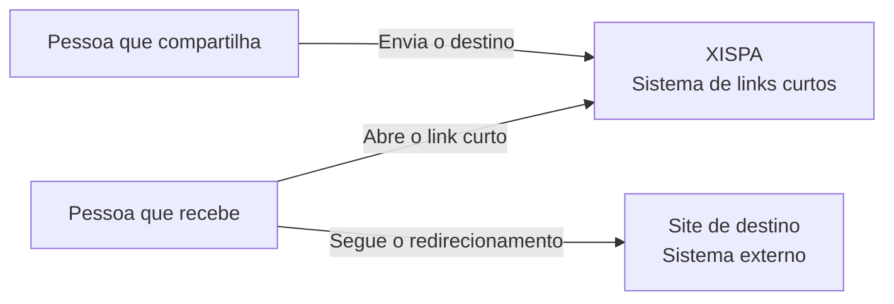
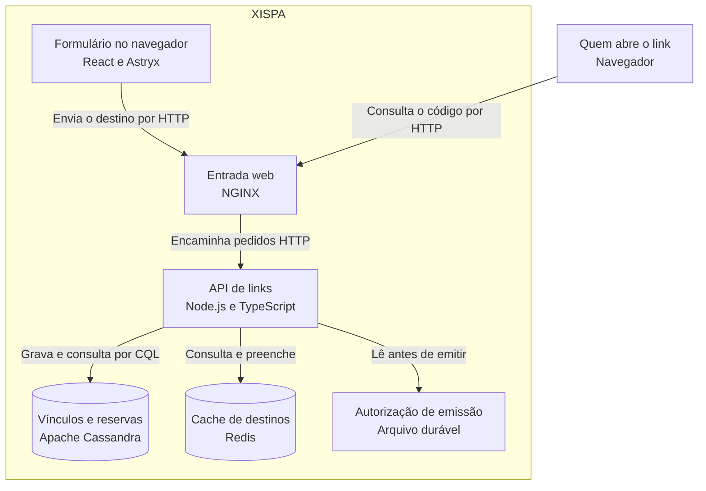
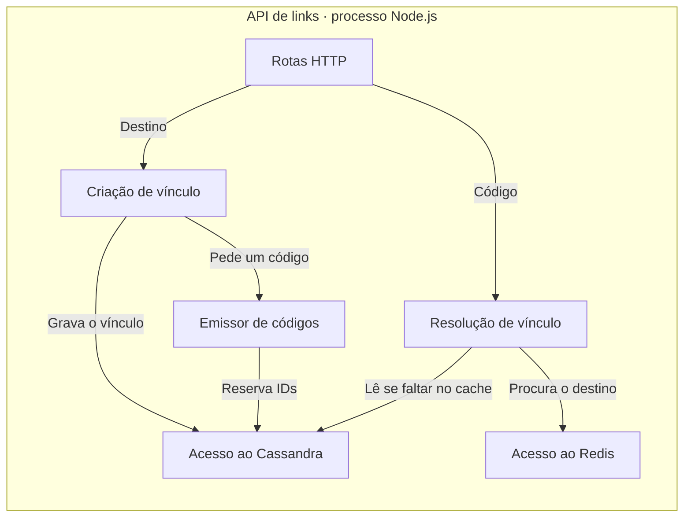

# Arquitetura do XISPA

O backend do XISPA é um **monólito modular**. Criar um link e redirecionar quem o abre são operações da mesma API, escrita em TypeScript e executada em Node.js. As rotas HTTP, a lógica dos links e o acesso aos dados ficam em módulos separados e se comunicam por chamadas de função dentro do mesmo processo. Cada réplica executa a API completa.

Se você abrir o `compose.yaml`, vai encontrar quatro serviços. O monólito roda em `api`. O `nginx` entrega o formulário React, construído com componentes Astryx e compilado pelo Vite, e encaminha os pedidos à API. Os outros dois serviços cuidam dos dados. O Cassandra guarda os links e as reservas de identificadores, e o Redis mantém em cache os destinos que a API já consultou. [Configuração do Docker Compose](../compose.yaml)

A modelagem segue o C4. O mesmo clique aparece em três níveis de detalhe. No **contexto**, ele vai do navegador ao XISPA e segue para o site de destino. A vista de **contêineres** mostra quais aplicações e bancos atendem o pedido. A de **componentes** entra em uma dessas aplicações, a API. [Modelo C4](https://c4model.com/diagrams)

## 1. Contexto

Na demonstração, quem preenche o formulário cola `https://www.google.com/` e recebe um link de `xispa.test`. Quando alguém abre esse link, o navegador consulta primeiro o XISPA e recebe o endereço original no cabeçalho HTTP `Location`. Com esse endereço, faz uma nova requisição, agora ao Google. É por isso que a seta até o site de destino parte de quem abriu o link. [Demonstração](../README.md#demonstração)

## 2. Contêineres

Tanto quem cria quanto quem abre um link chega ao NGINX. O caminho muda conforme o pedido. Em `GET /`, o NGINX entrega o formulário, que passa a executar no navegador. Ao clicar em **Encurtar**, o formulário envia o destino de volta ao mesmo domínio, desta vez para a API. Quem abre um link compartilhado vai direto à rota do código e recebe o redirecionamento sem carregar o formulário. [Formulário React](../web/src/Shortener.tsx) · [Rotas do NGINX](../deploy/nginx/rotas.conf)

| Pedido que chega à API | Resposta |
| --- | --- |
| `POST /api/v1/encurtar` com `{"url":"https://www.google.com/"}` | `201 Created` com o link curto no campo `short_url`. |
| `GET /{codigo}` ao abrir o link | `302 Found` com o endereço original em `Location`. |
| `POST /api/v1/redirecionar` com o link curto inteiro no campo `short_url` do JSON | O mesmo `302`, com o destino em `Location`. |

Os dois POSTs recusam dados inválidos com `400`. Se a API perder a confirmação do banco durante uma criação, devolve `503`. O vínculo pode ter sido gravado, e uma nova tentativa pode gerar outro link para o mesmo destino. [Contrato de criação](requisitos.md#rf-005) · [Formato dos pedidos](requisitos.md#rf-007)

Atrás da API, o Cassandra mantém duas tabelas. Em `links`, o código identifica uma linha com o destino e as datas de criação e vencimento. Em `reservations`, as réplicas reservam faixas de identificadores. O arquivo de autorização do diagrama guarda, fora do banco, o limite dessas faixas. Se o operador precisar restaurar um backup antigo, a marca atual permite retomar a emissão acima das faixas já autorizadas. [Esquema CQL](../deploy/cassandra/schema.cql) · [Emissão e recuperação](../deploy/ha/recuperacao.md)

## 3. Componentes da API

Para acompanhar o diagrama no código, comece pela função `startService`, em `src/service.ts`. Ela cria os clientes do Cassandra e do Redis uma vez por réplica e monta as duas funções que o servidor HTTP recebe, `create` e `resolve`. [Montagem da API](../src/service.ts)

**Ao criar um link**, a rota valida o destino e o entrega a `create`. Essa função pede um código ao emissor. Cada réplica consome IDs de um bloco que reservou no Cassandra. Enquanto há saldo, o emissor confere a autorização e usa o próximo ID da memória. Quando precisa de outro bloco, uma atualização condicional no banco impede duas réplicas de obterem o mesmo intervalo. Com o código em mãos, `create` grava o vínculo. Só depois da confirmação a rota junta o código a `PUBLIC_ORIGIN` e devolve o link. [Criação](../src/links/create.ts) · [Emissor](../src/ids/allocator.ts) · [Reserva de blocos](../src/storage/allocator.ts)

**Ao abrir o link**, o GET extrai o código do caminho. O POST de redirecionamento extrai o código do endereço enviado em JSON, depois de conferir a origem. Ambos chamam `resolve`. Se o Redis tiver um destino válido para esse código, a API já pode responder. Se a entrada faltar ou o cache estiver indisponível, `resolve` lê o Cassandra. Ao encontrar o vínculo vigente, devolve o destino e preenche o cache em segundo plano. A resposta é `404` se o vínculo venceu ou está ausente, e `503` se a consulta necessária falhou. [Rotas HTTP](../src/http/server.ts) · [Resolução](../src/links/resolve.ts)

## Decisões de arquitetura

### Por que usar Cassandra em vez de PostgreSQL?

Uma tabela com chave primária no código também atenderia à busca em PostgreSQL. A escolha do Cassandra vem do objetivo de estudar a distribuição dos links entre máquinas. A API consulta uma única partição por código usando CQL, a linguagem de consulta do Cassandra. Operar o cluster exige manter as réplicas em dia e redistribuir os dados ao acrescentar nós. [Modelagem no Cassandra](https://cassandra.apache.org/doc/latest/cassandra/developing/data-modeling/intro.html) · [Chaves primárias no PostgreSQL](https://www.postgresql.org/docs/current/ddl-constraints.html#DDL-CONSTRAINTS-PRIMARY-KEYS)

### Por que acrescentar o Redis se o Cassandra já busca pelo código?

Um link popular concentra as leituras na mesma partição. Guardar o destino no Redis poupa o Cassandra de repetir essa consulta a cada clique. Se o cache sair do ar, a API continua consultando o banco. [Cache de destinos](../src/cache/redis.ts)

### Por que o código tem sete caracteres?

É o menor comprimento que, com o alfabeto Base62, oferece códigos suficientes para o volume de criações previsto durante o período de retenção. [Formato do código](requisitos.md#rf-003) · [Capacidade prevista](requisitos.md#rnf-021)

### Como evitar que alguém descubra o próximo código?

O contador cresce dentro da instalação. Antes de publicar o código, o emissor aplica a permutação FF1 aos dígitos Base62 do ID. Isso oculta a sequência e mantém um código distinto para cada ID. [Codificação dos IDs](../src/ids/codec.ts)

### Por que usar um redirecionamento temporário se o destino é fixo?

O vínculo pode vencer. Com `302` e `Cache-Control: no-store`, o navegador volta a consultar a API na visita seguinte e ela pode conferir a validade do link. [Regra de retenção](requisitos.md#rf-008)

### O que muda quando o XISPA roda em várias máquinas?

As réplicas da API usam a mesma origem pública e leem os mesmos vínculos. Na topologia distribuída de referência, o Cassandra mantém três cópias de cada partição e exige confirmação de duas delas para ler ou gravar um vínculo. A tolerância à perda de um host e a vazão por 24 horas ainda precisam de ensaios em infraestrutura independente. [Topologia distribuída](../deploy/ha/topologia.md) · [Meta de vazão](requisitos.md#rnf-015)
