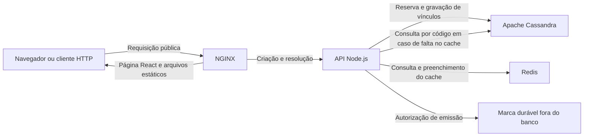

# Arquitetura do XISPA

Um link compartilhado precisa continuar apontando para o destino confirmado na criação, mesmo quando outra réplica atende à consulta ou o serviço reinicia. O vínculo é imutável e vence após dez anos civis. O domínio pertence ao operador. Qualquer pessoa pode criar ou abrir um link sem cadastro, e cada código contém exatamente sete caracteres. A mesma aplicação pode rodar em um host ou em uma instalação distribuída.

## O contrato HTTP

| Requisição | Resposta quando bem-sucedida | Por que existe |
| --- | --- | --- |
| `POST /api/v1/encurtar` com `{"url":"…"}` | `201 Created` e `{"short_url":"…"}` | Cria um vínculo depois de o Cassandra confirmar a gravação no nível de consistência configurado. O endereço devolvido usa `PUBLIC_ORIGIN`, independentemente do host pelo qual a API foi acessada. |
| `GET /{codigo}` | `302 Found`, `Location` e `Cache-Control: no-store` | Permite abrir o link diretamente em um navegador, inclusive com JavaScript desativado. |
| `POST /api/v1/redirecionar` com `{"short_url":"…"}` | O mesmo `302` e os mesmos cabeçalhos | Permite que uma integração entregue o link curto inteiro. A API exige a origem configurada e um caminho literal formado por uma barra e pelo código. |

O `302` apresenta o destino como temporário. Com `no-store`, um cliente que respeita o cabeçalho volta a consultar o serviço, onde o vencimento será conferido. [Semântica de 302 Found na RFC 9110](https://www.rfc-editor.org/rfc/rfc9110.html#section-15.4.3)

Uma criação com destino inválido ou um POST de resolução malformado recebe `400`. Um código ausente ou vencido recebe `404`. Uma operação necessária que expira ou falha sem confirmação recebe `503`. Se a resposta de criação se perder depois da gravação, uma nova tentativa poderá criar outro link para o mesmo destino. O NGINX evita repetir automaticamente um POST já enviado à API. [Rotas HTTP](../src/http/server.ts) · [Regras do proxy](../deploy/nginx/rotas.conf)

**Preservação do destino.** A criação aceita um endereço absoluto HTTP ou HTTPS com host, enviado em JSON UTF-8 de até 1 MiB. Espaços, barras invertidas, controles ASCII e Unicode malformado são rejeitados. A API valida o destino e armazena o texto original. Na resolução, ASCII conserva sua grafia byte a byte. Assim, `https://loja.example/café%2F?q=%2b#seção` produz `https://loja.example/caf%C3%A9%2F?q=%2b#se%C3%A7%C3%A3o` em `Location`. Os caracteres internacionais viram escapes de bytes UTF-8 e os escapes existentes mantêm sua caixa.

Um hostname internacional sem escapes prévios usa a conversão IDNA do Node.js. Quando o próprio host mistura Unicode e escapes, apenas os caracteres internacionais literais são codificados. Essa distinção conserva a grafia já aceita e permite ao navegador resolver o host. A expansão para `%HH` pode aproximar o cabeçalho de 3 MiB no limite do corpo. O NGINX reserva espaço para esse caso nas rotas de resolução, com custo de memória sob concorrência. [Validação da entrada](../src/links/link.ts) · [Construção de Location](../src/http/redirect.ts) · [Teste de cabeçalhos pela entrada](../tests/ops/redirecionamento.mjs)

## Por que o código tem sete caracteres

O requisito de capacidade é criar 100 milhões de links e resolver 1 bilhão em 24 horas, inclusive com dez consultas ao banco por criação durante a indisponibilidade do cache. Isso corresponde, em média, a cerca de **1.157 criações/s e 11.574 resoluções/s**. Para dimensionar o espaço de códigos, a hipótese é manter esse ritmo de **criação** durante dez anos. Em um intervalo de até 3.653 dias, seriam 365,3 bilhões de novos vínculos. As resoluções não consomem novos códigos. [Critérios do ensaio de carga](../tests/load/relatorio.md#ensaio-sustentado-de-24-horas)

O alfabeto Base62 usa os dez algarismos, 26 maiúsculas e 26 minúsculas. Com distinção de caixa e zeros à esquerda, há exatamente `62ⁿ` sequências de comprimento fixo `n`.

| Comprimento | Códigos possíveis | Comparação com o horizonte de 365,3 bilhões de criações |
| --- | ---: | --- |
| 6 caracteres | 62⁶ = 56.800.235.584 | Insuficiente mesmo usando todas as posições. |
| 7 caracteres | 62⁷ = 3.521.614.606.208 | O contador começa em 62⁴ = 14.776.336. Restam **3.521.599.829.872** posições em `[62⁴, 62⁷)`, antes de descontar faixas abandonadas. |

**Sete é o menor comprimento fixo em Base62 que atende a essa hipótese.** O piso `62⁴` reserva as primeiras posições do contador interno. O estoque de IDs é finito durante toda a vida da instalação. Vencer um vínculo libera os dados segundo a política do banco, mas seu código jamais volta ao emissor.

### Do ID interno ao código público

O contador interno é privado e crescente. A API converte cada ID em sete dígitos Base62 e aplica a permutação FF1-AES com chave e *tweak* fixos. Assim, IDs distintos geram códigos distintos e quem vê um link não consegue deduzir o próximo pela ordem de emissão. [Implementação](../src/ids/codec.ts) · [Vetores de teste](../src/ids/codec.test.ts)

## Concorrência e recuperação do contador

Para várias APIs emitirem em paralelo, o Cassandra mantém a linha `principal` da tabela `reservations`. Uma transação leve (LWT) usa `LOCAL_SERIAL` para avançar o cursor somente se o próximo ID livre, o teto autorizado, a geração e a impressão digital dos parâmetros ainda corresponderem à leitura. A atualização confirmada concede à réplica um bloco exclusivo, por padrão de até 1.024 IDs. Uma condição rejeitada permite reler o estado e disputar outro bloco. [Reserva condicional](../src/storage/allocator.ts)

A atomicidade cobre a **reserva do bloco**. Cada vínculo usa depois uma gravação CQL comum, e a API só devolve o código após a confirmação dessa escrita. Uma LWT por criação exigiria coordenar cada novo link na mesma linha. Em blocos, as réplicas distribuem posições já reservadas localmente. Blocos maiores reduzem a frequência de coordenação, mas podem deixar mais posições sem uso no reinício. Se a confirmação se perde, a réplica descarta aquela tentativa. Se a reserva foi aplicada no banco, o bloco inteiro fica sem uso. [Emissor local](../src/ids/allocator.ts) · [Gravação do vínculo](../src/links/create.ts)

Um snapshot pode fazer o cursor retroceder para antes de códigos já entregues. Por isso a administração registra também, fora do Cassandra, a geração e o teto exclusivo de **todas** as faixas autorizadas. A nova marca é persistida com sincronização em disco e troca atômica de arquivo antes da autorização no banco. Cada API relê a marca antes de consumir um ID, mesmo que já possua um bloco. O custo é uma leitura externa por criação e a dependência de armazenamento coerente entre as réplicas.

Na restauração, os emissores antigos são isolados e a marca mais recente é congelada. Com uma nova geração, a retomada usa como primeiro ID o último teto exclusivo comprovado, descartando a faixa sobre a qual há dúvida. A marca e o banco são atualizados em etapas. Uma interrupção pode suspender a criação até reconciliar os dois estados. Sem marca atual comprovada ou sem faixa superior disponível, o banco restaurado permanece em leitura. Vínculos posteriores ao backup podem ter sido perdidos, mas seus códigos não serão atribuídos a outros destinos. [Administração da emissão](../src/ids/recovery.ts) · [Backup e restauração](../deploy/ha/recuperacao.md)

## Cassandra e Redis no caminho de leitura

O Apache Cassandra é um banco distribuído da família de colunas largas (*wide-column*). **CQL**, sigla de *Cassandra Query Language*, é a linguagem usada para definir as tabelas e consultar seus dados. A tabela `links` foi desenhada para recuperar, a partir de um código conhecido, o destino e o instante até o qual ele está vigente. O código é a chave de partição. Uma consulta preparada recupera o destino e os dois instantes em uma única partição. [Esquema do XISPA](../deploy/cassandra/schema.cql) · [Consulta por código](../src/storage/read.ts) · [Modelagem orientada a consultas no Cassandra](https://cassandra.apache.org/doc/latest/cassandra/developing/data-modeling/intro.html)

A escala horizontal vem do particionamento e da distribuição das réplicas entre os nós. Um hash do código determina sua posição no anel de tokens. As faixas de tokens distribuem o conjunto de vínculos, e o fator de replicação define quantas cópias de cada partição o cluster mantém. Novos nós podem assumir parte dessas faixas e das requisições que elas recebem. Uma única partição muito lida continua sendo atendida pelo seu conjunto de réplicas. Para um serviço pequeno, uma tabela relacional com índice por código também resolve a busca direta. Consultas por destino ou período exigiriam outra modelagem no esquema atual. [Particionamento e replicação no Cassandra](https://cassandra.apache.org/doc/latest/cassandra/architecture/dynamo.html)

O vencimento ocorre no mesmo horário UTC dez anos civis depois da criação. Se o vínculo começou em 29 de fevereiro e o ano de destino é comum, vence em 28 de fevereiro. A API verifica `agora < expires_at` tanto no banco quanto no cache. O TTL físico do Cassandra é o tempo restante em segundos, arredondado para cima, mais um segundo e a tolerância de relógio configurada. Essa margem evita remoção prematura enquanto os relógios se mantêm dentro da tolerância. A compactação recupera espaço em disco posteriormente. Expirações além de 2038 exigem o formato compatível do Cassandra 5. [Escrita com TTL](../src/storage/write.ts) · [Medição dos relógios](../deploy/demo/relogios.md)

Um link popular concentra leituras em uma única partição. O Redis reduz essas consultas repetidas com a chave `INSTALLATION_ID:codigo`. Só guarda resultados positivos, por no máximo o menor entre o TTL do cache e a vida restante do vínculo. Na leitura, a API confere sintaxe do destino e vigência. Se a chave faltar, o valor for inválido ou o Redis falhar, consulta o Cassandra. O preenchimento após uma leitura confirmada ocorre em segundo plano. A espera pelo Redis usa no máximo metade do prazo HTTP restante, limitada ainda por `CACHE_TIMEOUT_MS`. Isso deixa tempo para tentar a leitura persistente.

Uma instalação pode resolver links com o Redis fora do ar, ao custo de mais leituras no banco. Com Cassandra indisponível, uma entrada válida no cache ainda pode servir o vínculo. Uma falta no cache nesse cenário ou uma criação que exige o banco retorna `503`. Um acerto dispensa a conferência do destino no Cassandra e, por isso, a integridade das chaves depende do controle de escrita no Redis. [Caminho de resolução](../src/links/resolve.ts) · [Adaptador Redis](../src/cache/redis.ts)

## Interface, entrada e distribuição

A página React usa os campos, botões e anúncios acessíveis do Astryx para indicar andamento, erro e confirmação, inclusive por teclado. Um envio em curso bloqueia outra submissão. Se a cópia automática falhar, o campo recebe foco e seleciona o link inteiro. O Vite compila a interface em arquivos estáticos servidos pelo NGINX na mesma origem da API. Esse arranjo dispensa um servidor de renderização para o formulário. Em contrapartida, o formulário precisa carregar JavaScript. [Formulário](../web/src/Shortener.tsx) · [Testes no navegador](../web/tests/formulario.mjs)

A API usa TypeScript e o servidor HTTP nativo do Node.js, com um processo por contêiner e clientes de dados reutilizados. As três rotas compartilham validação e regras de negócio, sem exigir um framework de aplicação. O serviço assume diretamente os prazos HTTP, a validação em tempo de execução e a drenagem durante a parada. O NGINX serve os arquivos, encaminha as requisições públicas e mantém as sondas e métricas em `/internal/` acessíveis pela rede privada. A separação em imagens permite instalar sem compilar no host e acrescentar réplicas da API conservando os links. [Composição da API](../src/service.ts) · [Instalação](instalacao.md) · [Métricas por processo](../tests/ops/metricas.md)

## Topologias, capacidade e evidência

| | Instalação local | Referência distribuída |
| --- | --- | --- |
| Cassandra | Um nó, fator de replicação (RF) 1 e consistência `ONE`. A perda desse nó impede as gravações e as leituras persistentes. | Três nós em domínios de falha distintos no mesmo datacenter, com `NetworkTopologyStrategy` e RF 3. `LOCAL_QUORUM` requer duas das três réplicas para confirmar leituras e escritas de vínculos. O quórum de leitura inclui ao menos uma réplica que confirmou a escrita. Um nó pode falhar e ainda restar quórum. Com dois indisponíveis, a criação e a resolução com cache frio devolvem `503`. |
| Entrada e emissão | Uma API e um NGINX. O projeto inteiro compartilha o host. | Duas APIs e duas entradas em hosts distintos, origem pública com balanceador redundante ou endereço virtual e diretório da marca coerente e redundante. A continuidade depende também desses componentes e da conectividade entre eles. |

A expansão do banco requer ingresso dos novos nós e redistribuição dos dados. Ao elevar um keyspace já populado de RF 1 para RF 3, a alteração de schema deve ser seguida de reparo das faixas existentes. Aumentar o número de APIs distribui trabalho HTTP, mas a marca, as reservas e a capacidade de leitura e escrita do banco continuam compartilhadas. [Topologia e expansão](../deploy/ha/topologia.md) · [Ensaio de perda de host](../tests/ops/failover.md)

Na hipótese de 365,3 bilhões de vínculos ativos com destinos de **100 bytes em média**, os textos somam 36,53 TB decimais em uma cópia ou 109,59 TB com RF 3. O consumo físico inclui também chaves, timestamps, metadados, compactação, backups e folga para reconstrução após perda de nó. O dimensionamento precisa de medidas com a distribuição real de destinos e de acessos. [Projeção de disco e ensaio de 24 horas](../tests/load/relatorio.md)

Os ensaios locais exercitaram criação, resolução por ambas as rotas, reinício com cache frio e restauração. Em uma VM Linux de 2 GiB com vizinho sintético e a pilha completa, a maior soma simultânea de memória dos contêineres foi 1.105,68 MiB, com mínimo de 548,64 MiB disponíveis no host. Essa medição descreve a carga da demo. A margem da VPS com os vizinhos reais, a vazão por 24 horas e a continuidade após perda de um host físico permanecem sujeitas a ensaios próprios. [Qualificação da demo](../deploy/demo/qualificacao.md) · [Guia de testes](../CONTRIBUTING.md)
